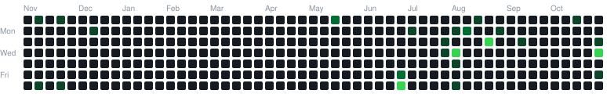
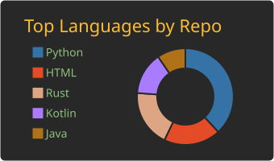
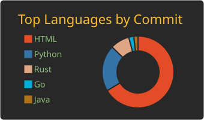
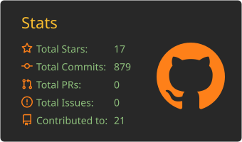
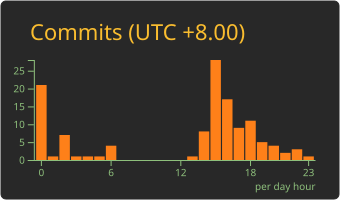

  

  

  

<!-- Tech Stack -->

  
  
  
  
  

  

 

<!-- Featured Tooling & Research -->
<h3 align="center">⚡ Core Arsenal & Research</h3>

| Target / Repository | Focus & Domain | Stack | Status |
| :--- | :--- | :--- | :---: |
| [**Petro**](https://github.com/i-mrsam/Petro) | Network Reconnaissance & Security Scanning | Python / Network | `Active` |
| [**Filtering-Analysis-Tool**](https://github.com/i-mrsam/Filtering-Analysis-Tool) | DPI & Network Filtering Analysis | Python / Sockets | `Maintained` |
| [**TimeZone**](https://github.com/i-mrsam/TimeZone) | Android Hooking & Per-App Locale Override | LSPosed / Java | `Stable` |
| [**Process-Monitor**](https://github.com/i-mrsam/Process-Monitor) | Linux Process Inspection & Kernel Monitoring | Bash / Linux | `Core` |
| [**ChatAi**](https://github.com/i-mrsam/ChatAi) | Android AI Client backed by Cloudflare Workers | Kotlin / Workers | `Active` |

 

<!-- Contribution Dynamics: Conway's Game of Life -->
<h3 align="center">👾 Conway's Game of Life (Contribution Matrix)</h3>

  <picture>
    <source media="(prefers-color-scheme: dark)" srcset="https://raw.githubusercontent.com/i-mrsam/i-MrSAM/output/conway-life-dark.svg">
    <source media="(prefers-color-scheme: light)" srcset="https://raw.githubusercontent.com/i-mrsam/i-MrSAM/output/conway-life.svg">
    
  </picture>

<!-- Profile Summary Cards -->

  

  
  

  
  

  

<!-- Deep Insights Accordion -->

 <b>📊 Deep Telemetry & Extended Metrics</b> 

 

  <a href="https://next.ossinsight.io/widgets/official/analyze-user-contribution-time-distribution?user_id=19436819&period=all_times" target="_blank">
    <picture>
      <source media="(prefers-color-scheme: dark)" srcset="https://next.ossinsight.io/widgets/official/analyze-user-contribution-time-distribution/thumbnail.png?user_id=19436819&period=all_times&image_size=auto&color_scheme=dark" width="700">
      
    </picture>
  </a>

  <a href="https://next.ossinsight.io/widgets/official/compose-user-dashboard-stats?user_id=19436819" target="_blank">
    <picture>
      <source media="(prefers-color-scheme: dark)" srcset="https://next.ossinsight.io/widgets/official/compose-user-dashboard-stats/thumbnail.png?user_id=19436819&image_size=auto&color_scheme=dark" width="700">
      
    </picture>
  </a>

  <a href="https://next.ossinsight.io/widgets/official/compose-org-activity-map?activity=stars&role=stars&owner_id=19436819&period=past_12_months" target="_blank">
    <picture>
      <source media="(prefers-color-scheme: dark)" srcset="https://next.ossinsight.io/widgets/official/compose-org-activity-map/thumbnail.png?activity=stars&role=stars&owner_id=19436819&period=past_12_months&image_size=4x7&color_scheme=dark" width="700">
      
    </picture>
  </a>

  

 

<!-- Security Clearance & PGP -->

  <pre><code>[+] PGP Fingerprint : <b>732B CDDA D8A9 01EF 42CE  0BE1 05D4 486F ECF1 EAA1</b>
[+] Key Algorithm   : <b>Ed25519 (ECC)</b> | Status: <b>VERIFIED</b></code></pre>

<!-- Security & Contact Clearance -->
 

  
  

 

<!-- Footer -->

  

  
  

